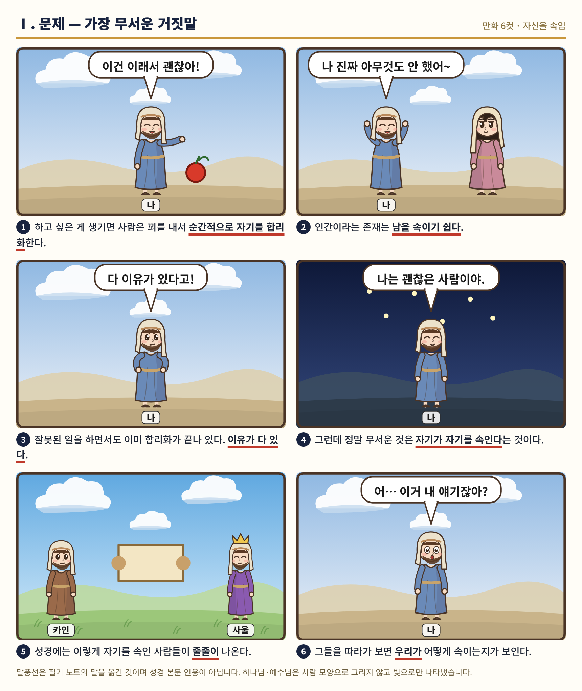
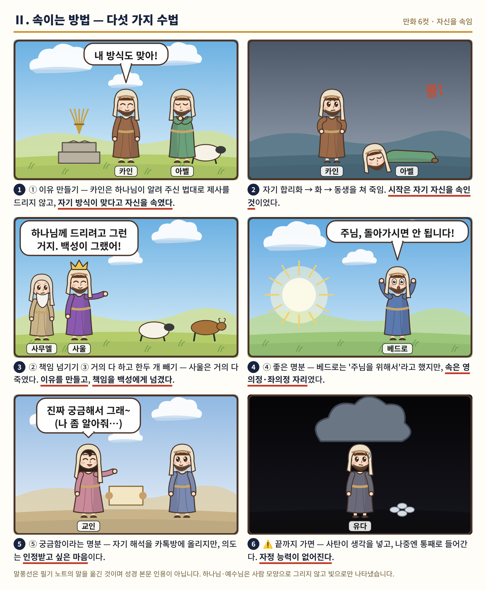
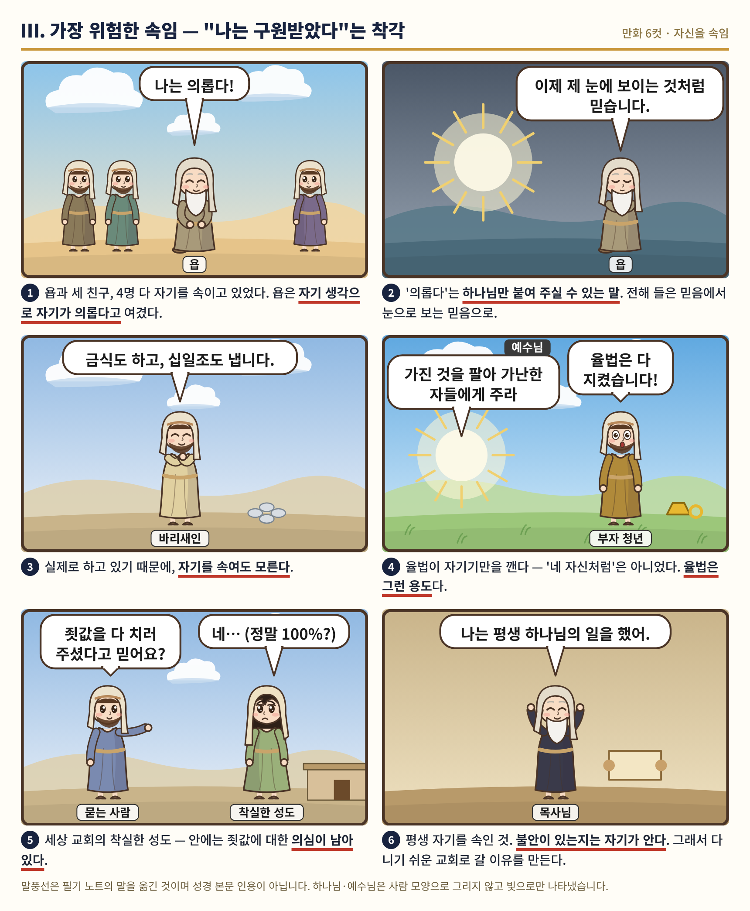
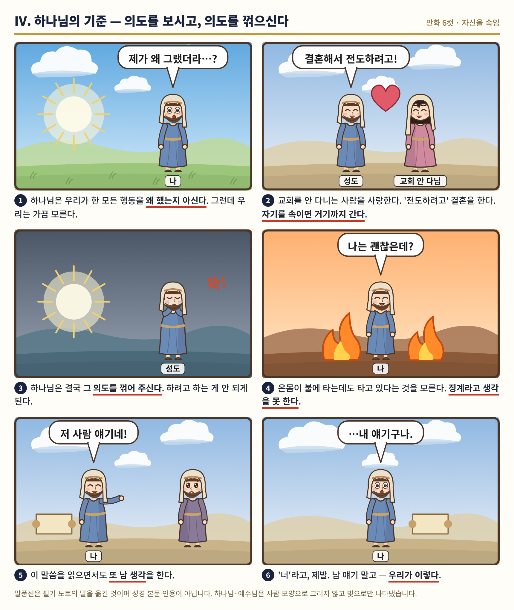
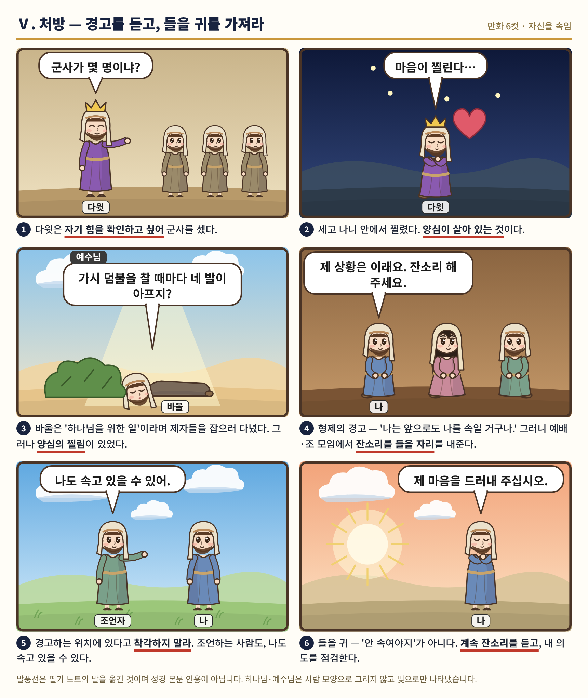

# 강의 필기 노트 — 자신을 속임 (2026-11-08)

> 한 줄 요약: **사람은 남보다 자기 자신을 더 잘 속인다. 하나님은 행동이 아니라 의도를 보신다. 그러니 "안 속여야지"가 아니라, 경고를 듣는 귀를 열어 두고 내 의도를 점검하라.**

**읽는 법** — 카테고리마다 ① 📖 이야기 → ② 📌 핵심 정리 → ③ 🎨 만화 6컷 순서입니다. 「교회 교리로 보면」 상자는 밀크 교리 정리(`docs/doctrine/00_교리_총정리.md`)와 첫열매들 강의에서만 가져왔습니다. 성경 본문은 장절만 적었습니다.

---

## Ⅰ. 문제 — 가장 무서운 거짓말

### 📖 이야기
하고 싶은 게 생긴다. 그 순간 머릿속에서 꾀가 돌아간다. "이건 이래서 괜찮아." 잘못된 일을 하고 있으면서도, 누가 물어보면 이유가 술술 나온다. 이미 합리화가 끝나 있기 때문이다.

사람은 남을 참 잘 속인다. 그런데 남을 속이면 언젠가 들통이라도 난다. 정말 무서운 건 **자기가 자기를 속이는 것**이다. 그건 속고 있다는 것조차 모른다.

성경에는 이렇게 자기를 속인 사람들이 줄줄이 나온다. 카인, 사울, 베드로, 유다, 욥, 바리새인… 그들을 따라가다 보면 어느 순간 이런 말이 나온다. "어… 이거 내 얘기잖아?"

### 📌 핵심 정리
📖 예레미야 17:9 / 전도서 7:29 / 잠언 21:2
- 인간은 남을 속이기 쉽다.
- 하고 싶은 게 있으면 꾀를 내서 **순간적으로 자기 합리화**를 한다.
- 잘못된 일을 하면서도 이미 합리화가 끝나 있다 — 이유가 다 있다.
- 정말 무서운 것은 **자기가 자기를 속인다는 것**이다.

### 🎨 만화 6컷

---

## Ⅱ. 속이는 방법 — 다섯 가지 수법

### 📖 이야기
**카인**은 하나님이 알려 주신 법대로 제사를 드리지 않았다. 그런데 속으로 말한다. "내 방식도 맞아." 하나님이 받지 않으시자 억울하고 화가 났다. 그 화는 결국 동생을 쳐 죽이는 데까지 갔다. 끔찍한 끝도, 시작은 작은 자기 속임이었다.

**사울**은 아말렉을 거의 다 죽였다. 정말 많이 죽였다. 그런데 좋은 것 몇 개를 남겼다. 사무엘이 따지자 두 마디가 나온다. "하나님께 드리려고 그런 거지." 그리고 "백성이 그랬어." 이유를 만들고, 책임을 넘긴다. 하나님 말씀을 거의 다 들으면서 내가 하고 싶은 것 한두 개만 빼는 것 — 이게 우리가 하는 짓이다.

**베드로**는 예수님이 죽으신다는 말씀에 "주님, 돌아가시면 안 됩니다!" 하고 막아선다. 주님을 위해서라고 생각했다. 그런데 속에는 예수님이 빨리 황제가 되셔서 자기가 영의정·좌의정에 앉고 싶은 마음이 있었다. **바나바**에게도 "사이프러스 교회에 한 번 더 가서…"라는 자기 논리가 있었고, 사도행전은 그 뒤로 바울을 따라간다.

**우리 교회 안**에도 이 이야기가 있다. 성경 공부 열심히 하는 분이 어느 날 "예배 시간엔 이렇게 배웠지만 제 생각에는…" 하며 개인 해석을 내놓는다. "우리 교회를 위해서"라며 다른 성도를 뒤에서 험담한다. 또 어떤 **교인**은 "진짜 궁금해서 그래" 하며 자기 해석을 카톡방에 올린다. 그런데 속마음은 "나 성경 많이 공부했어, 나 좀 알아줘"다. 남은 몰라도 자기는 그 차이를 안다.

그리고 이것이 쌓여 끝까지 가면 **유다**가 된다. 처음엔 사탄이 머릿속에 생각을 넣고, 나중엔 통째로 들어간다. 스스로 바로잡는 힘, 자정 능력이 없어진다.

### 📌 핵심 정리
**① 이유 만들기 — 카인** · 📖 창세기 4:3-7
- 하나님이 제사 법을 알려 주셨을 것이다. 아벨은 그 법대로, 카인은 그 법대로 하지 않았다.
- "내 방식이 맞다"고 자신을 속임 → 자기 합리화 → 화 → 동생을 쳐 죽임.
- **시작은 자기 자신을 속인 것.**

**② 책임 넘기기 — 사울** · 📖 사무엘상 15:2-3, 9, 13-15
- 첫째, **이유를 만든다** — "하나님께 드리려고 그런 거지."
- 둘째, **잘못되면 내 책임이 아니다** — 순간적으로 백성에게 넘김. 왕이 백성이 시킨 걸 했다고?

> **교회 교리로 보면** — 「용서 받지 못하는 회개」: 죄를 지을 때 1단계 자기 합리화, 2단계 책임을 다른 사람에게 돌림([39:33](https://youtu.be/Sa3ihXR_f8o?t=2373), [39:49](https://youtu.be/Sa3ihXR_f8o?t=2389)).

**③ 거의 다 하고, 한두 개 빼기 — 사울, 그리고 우리**
- 하나님이 시킨 일을 **거의** 한다. 거의 다 죽였다, 많이 죽였다.
- 하나님 말씀을 꽤 많이 들으면서 **내가 하고 싶은 것 한두 개를 뺀다.** 그리고 이유를 만든다.

> **교회 교리로 보면** — 「용어의 정의_징계」: 다 버렸다면서 원하는 것 몇 개는 안 죽이고, "아주 기가 막힌 그럴 듯한 이유로 자기가 자기를 합리화" — 그것 때문에 맞는다([1:01:20](https://youtu.be/K2oLTyo0zN8?t=3680)–[1:01:47](https://youtu.be/K2oLTyo0zN8?t=3707)).

**④ "○○을 위해서"라는 명분 — 베드로 · 바나바 · 교회 안의 성도** · 📖 마태복음 16:21-23 / 사도행전 13:2, 4, 12 / 15:39 / 야고보서 1:22, 26-27
- 베드로: "주님을 위해서" — 속은 영의정·좌의정. 이유는 "예수님을 위해서야."
- 바나바: 자기 논리 — "사이프러스 교회에 한 번 더 가서…" → 사도행전은 바울을 따라감.
- 교회 안의 성도(고아나 과부들 이야기): 성경 공부 열심 → "제 생각에는…" 개인 해석 → "교회를 위해서" 뒤에서 험담 → 합리화.
- 👉 물어라: **이게 정말 교회를 위한 일인가?**

**⑤ "진짜 궁금해서"라는 명분 — 교인들** · 📖 로마서 16:17-18 / 사도행전 20:30
- (배운) 해석과 다른 얘기는 얼마든지 할 수 있다 — "이렇게 볼 수 있는 거 아냐?"
- **진짜 궁금해서 묻는 것 ≠ 인정받고 싶어서 묻는 것.** ("나 성경 많이 공부했어, 나 좀 알아줘")
- 자기 해석을 카톡방에 올리는 의도는 궁금함이 아니다 → **자기가 자기를 속이는 것.**

**⚠️ 끝까지 가면 — 유다** · 📖 요한복음 12:3-6
- 사탄이 머릿속에 **생각을 넣음** → 나중엔 **통째로 들어감**.
- **자정 능력이 없어져 버린다.**

### 🎨 만화 6컷

---

## Ⅲ. 가장 위험한 속임 — "나는 구원받았다"는 착각

### 📖 이야기
**욥**과 세 친구, 네 사람 모두 자기를 속이고 있었다. 욥은 자기 생각으로 자기가 의롭다고 여겼다. 그러나 "의롭다"는 하나님 나라에 들어갈 자격이 있다는 말이다. 하나님 기준이고, 사람이 자기에게 감히 붙일 수 없는 말이다. 그래서 하나님은 욥을 칭찬하시면서도 "의롭다", "정당하다"는 말은 쓰지 않으신다. 장장 32장에 가서야 엘리후와 하나님을 통해 올바른 소리가 나오고, 욥은 마침내 고백한다. "이제 제 눈에 보이는 것처럼 믿습니다." 자기를 속이는 문제가 얼마나 심각하길래, 하나님은 성경 한 권을 통째로 여기에 쓰셨을까?

**바리새인**을 우습게 보면 안 된다. 금식도, 십일조도 실제로 한다. 성품도 대단했을 것이다. 바로 그래서 위험하다. 하고 있기 때문에 자기를 속여도 모른다.

**부자 청년**은 "율법은 다 지켰습니다!" 한다. 정말 한 번도 남의 것을 탐한 적이 없었을까? 꽤 많이 나눠 줬을 것이다. 그래도 "네 자신처럼"은 아니었다. 그래서 예수님이 "가진 것을 팔아 가난한 자들에게 주라" 하신다. 자기를 속이는 껍데기를 깨 버리시려고. 그 일에 율법이 쓰인다.

**세상 교회의 착실한 성도**에게 "예수님이 당신 죗값을 완전히 치러 주셨다고 믿습니까?" 물으면 "네" 한다. 그런데 정말 100%일까? 안에는 의심이 남아 있다.

그리고 **"나는 평생 하나님의 일을 했어"** 하는 목사님들. 평생 자기를 속인 것이다. 대속의 약속에 의심이 남아 있는지, 불안이 있는지는 솔직히 자기가 안다. 그런데 모른 체한다. 이단 소리 듣는 교회에 다니는 건 힘드니까, 다니기 쉬운 교회로 갈 이유를 또 만든다.

### 📌 핵심 정리
**① 욥 — 이 문제 하나로 성경 한 권** · 📖 욥기 32:1-2, 33:8-9 / 40:8
- (욥과 세 친구) 4명 다 자기를 속인다. 32장부터 올바른 소리 — 엘리후, 하나님.
- **의롭다(righteous) = 하나님 나라에 들어갈 자격.** 하나님 기준. 인간이 자기에게 못 붙이는 말.
- 전해 들은 것처럼 믿음 → "이제 제 눈에 보이는 것처럼 믿습니다."
- 하나님의 칭찬에 **"의롭다", "정당하다"가 없다** — 하나님만 붙이실 수 있다.

> **교회 교리로 보면** — 욥기는 "흐릿한데 선명한 척, 평화가 없는데 있는 척" 때문에 한 권을 쓰셨다. 귀로 듣던 것 → 눈으로 보는 것 → 회개. **흐릿하면 흐릿하다고 대답해야 산다**(요 9:41). (밀크 교리 정리 §4)

**② 바리새인** · 📖 누가복음 18:9, 11-12
- 금식·십일조를 **실제로 한다** → **하고 있기 때문에 속여도 모른다.**
- 자기가 구원받았다고 자기를 속인다 — 바리새인처럼, 욥처럼.

**③ 부자 청년 — 율법이 자기기만을 깬다** · 📖 마태복음 19:16-17, 19-21
- "다 지켰다" — 10계명 "탐하지 말라"를 정말?
- "네 이웃을 네 자신과 같이" — 많이 나눴어도 **"네 자신처럼"은 아니었다.**
- "가진 것을 팔아 주라" = 자기기만을 **깨 버리시는** 말씀. **율법은 그런 용도.**

> **교회 교리로 보면** — 천국·지옥의 기준은 모세의 율법, **죄가 하나라도 있으면 지옥**(약 2:10). 율법은 "이것으로는 못 간다"는 **양심의 소리**를 올라오게 하는 교육용(밀크 교리 정리 §3). 「용어의 정의_징계」: "율법은 너희가 죄인인 거 깨달으라고 준 거야"([3:31](https://youtu.be/K2oLTyo0zN8?t=211)).

**④ 세상 교회의 착실한 성도**
- "죗값을 완전히 지불해 주셨나?" → "그렇다." 그런데 **정말 100%?**
- 안에 의심이 남아 있으면서 자기를 속인다.

**⑤ 목사님들** · 📖 마태복음 7:21 / 누가복음 13:24, 26-27
- "나는 평생 하나님의 일을 했어" = **평생 자기를 속인 것.**
- 믿는지, 불안이 있는지, 의심이 남았는지 — **자기가 안다.** 그런데 모른 체한다.
- 이단 소리 듣는 교회는 힘드니 **다니기 쉬운 교회로 갈 이유를 만든다.**

> **교회 교리로 보면** — 최선을 다해 믿는 믿음 vs **의심이 조금도 없는 꽉 찬 확신**(히 10:22). 확인 질문은 하나: **"지금 죽는다면 지옥 걱정이 조금도 없는가?"** 이 믿음은 교제와 말씀 가운데 선물로 받는다. 받은 증인들도 대부분 주류 교회에 핍박받았다. (밀크 교리 정리 §4)

### 🎨 만화 6컷

---

## Ⅳ. 하나님의 기준 — 의도를 보시고, 의도를 꺾으신다

### 📖 이야기
사람은 행동을 보지만, 하나님은 **왜 그랬는지**를 보신다. 우리가 한 모든 행동의 의도를 아신다. 그런데 정작 나는, 가끔 내가 왜 그랬는지 모른다.

어떤 성도가 교회를 안 다니는 사람을 사랑한다. 그리고 말한다. "결혼해서 전도하려고!" 그럴듯하다. 하지만 자기를 속이면 거기까지 간다. 하나님은 결국 그 의도를 꺾어 주신다. 하려던 일이 안 되게 된다.

그런데 더 무서운 게 있다. 하나님이 꺾으시고 매를 드시는데도, 자기를 속이는 사람은 그게 징계인 줄 모른다. 온몸이 불에 타는데 "나는 괜찮은데?" 한다. 그리고 이 말씀을 읽으면서도 또 남을 떠올린다. "저 사람 얘기네!" — 아니다. "너"라고, 제발. 우리가 이렇다.

### 📌 핵심 정리
**① 의도로 심판하신다** · 📖 고린도전서 4:5 / 시편 44:21 / 예레미야 17:10
- 하나님은 모든 행동을 **왜 했는지** 아신다. 우리는 (가끔) 모른다.

**② 의도를 꺾으신다** · 📖 야고보서 4:1-4
- 교회 안 다니는 사람을 사랑해서 **"결혼해서 전도하려고"** 결혼한다.
- 자기를 속이면 거기까지 간다. → 하나님은 결국 그 **의도를 꺾어 주신다.** 하려는 게 안 되게 된다.

**③ 그런데 징계를 인식하지 못한다** · 📖 이사야 42:24-25
- 온몸이 불에 타는데 **타고 있다는 것을 모른다.** 징계라고 생각을 못 한다.
- 이것도 남 생각? **"너"라고, 제발.** 우리가 스스로를 속여 놓고, 징계를 받아 놓고도 모른다.

> **교회 교리로 보면** — 예수님이 벌받아 주신 옛 죄와 달리, 새 계명("서로 사랑하라", 요 13:34)을 어긴 새 죄는 성도 책임이고 **징계**로 온다(밀크 교리 정리 §3). 「용어의 정의_징계」: 하나님이 참다 참다 회초리를 드시는 것 → 회개 = 방향을 하나님 쪽으로([1:23](https://youtu.be/K2oLTyo0zN8?t=83), [3:06](https://youtu.be/K2oLTyo0zN8?t=186)).

### 🎨 만화 6컷

---

## Ⅴ. 처방 — 경고를 듣고, 들을 귀를 가져라

### 📖 이야기
**다윗**은 자기 힘이 얼마나 되는지 확인하고 싶었다. "군사가 몇 명이냐?" 다 세고 나니 안에서 찔렸다. 양심이 살아 있었던 것이다. **바울**은 "하나님을 위한 일"이라며 예수님의 제자들을 잡아 돌로 치고 다녔다. 겉으론 하나님을 위한다며 자기를 속였다. 그러나 예수님은 말씀하신다. "가시 덤불을 찰 때마다 네 발이 아프지?" 양심이 살아 있는 게 제일 좋다. 누구도 계속 이럴 수는 없다.

그럼 오늘 예배가 끝나고 무엇을 해야 할까? "이제 나를 안 속여야지" — 이건 목표가 아니다. 대신 이렇게 받아들인다. "나는 나를 속이는구나. 앞으로도 계속 속일 거구나." 그러니 예배에 열심히 나오고, 조 모임에 내 상황을 털어놓고, 형제들이 나에게 잔소리할 수 있게 자리를 내준다. 그리고 내가 조언할 때도 "나는 경고하는 자리"라고 착각하지 않는다. 조언하는 나도 속고 있을 수 있다.

결국 필요한 건 **들을 귀**다. 계속 잔소리를 듣는 귀. 이런 말씀을 읽을 때 남이 아니라 "내가 그렇구나" 하는 귀. "저는 제 마음을 잘 모르니, 좀 드러내 주십시오."

### 📌 핵심 정리
**① 양심의 경고** · 📖 사무엘하 24:10 / 사도행전 9:5
- 경고는 **우리 스스로의 양심에서** 온다.
- 다윗: 자기 힘을 알고 싶어 군사를 셈 → 세고 나니 **찔림** = 양심이 살아 있음.
- 바울: "하나님을 위한 일"이라며 제자들을 죽임 = 자기를 속임 → "가시 덤불을 찰 때마다 네 발이 아프지?" → 바울은 (끝까지) 자기를 속이지는 않았다.
- **양심이 살아 있는 게 제일 좋다.** 누구도 계속 이럴 수는 없다.

**② 형제의 경고** · 📖 히브리서 3:13 / 갈라디아서 6:1, 3
- "나는 나를 속이는구나 → 앞으로도 계속 속일 거구나 → 그러니 예배·조 모임에서 잔소리를 들을 수 있게 하자."
- **"나는 나를 안 속여야지"는 목표로 세우지 않는다.**
- **경고하는 위치에 있다고 착각하지 말라.** 조언자도, 나도 속고 있을 수 있다 — 이렇게 듣는다.

**③ 의도를 점검하라** · 📖 시편 36:2 / 139:23-24
- 누가 **콕 찔러서 드러내 주지 않으면** 자기를 속인 채로 계속 산다.
- 구절을 읽을 때 남을 떠올리면 유익이 없다 → **"내가 그렇구나."**
- "내가 화가 나는 게 사실 내 잘못일 수도 있겠구나." / "저는 제 마음을 잘 모르니, 좀 드러내 주십시오."

**④ 들을 귀** · 📖 디모데전서 1:19 / 시편 141:5 / 잠언 15:31-32
- **계속 잔소리를 들어야 한다.**
- **들을 귀가 있어야 한다.**
- "내 자신을 속이지 말아야지"가 아니다.

> **교회 교리로 보면** — 「용어의 정의_징계」: 내가 모르고 잘못 갈 때 교제 안의 교회 사람이 지적하면 들어야 한다. "여러분 자신을 속이지 마세요 우린 다 안 들어요" — 바로 이유가 튀어나오고, 더 나쁠 땐 "그러는 너는?"([38:39](https://youtu.be/K2oLTyo0zN8?t=2319)–[39:28](https://youtu.be/K2oLTyo0zN8?t=2368)). **교제** = 말씀과 성령이 채워지는 통로(밀크 교리 정리 §7).

### 🎨 만화 6컷

---

## 한눈에 보기

| 카테고리 | 사람 | 자기를 속인 말 / 처방 |
|---|---|---|
| Ⅰ 문제 | 우리 | "이건 이래서 괜찮아" — 이유가 다 있다 |
| Ⅱ 이유 만들기 | 카인 | "내 방식도 맞아" → 화 → 살인 |
| Ⅱ 책임 넘기기 | 사울 | "하나님께 드리려고", "백성이 그랬어" |
| Ⅱ 거의 다 하고 한두 개 빼기 | 사울, 우리 | 거의 다 순종, 하고 싶은 것만 뺌 |
| Ⅱ 좋은 명분 | 베드로·바나바·교회 안 성도 | "주님을 위해서", "교회를 위해서" |
| Ⅱ 궁금함이라는 명분 | 교인들 | "진짜 궁금해서" (속은 "나 좀 알아줘") |
| Ⅱ 끝까지 가면 | 유다 | 자정 능력을 잃음 |
| Ⅲ 구원 착각 | 욥·바리새인·부자 청년·세상 교회 성도·목사님들 | "나는 의롭다", "다 지켰다", "믿는다(100%?)", "평생 하나님의 일을 했어" |
| Ⅳ 의도로 심판 / 꺾으심 | 불신자와 결혼하려는 성도 | "결혼해서 전도하려고" → 결국 안 되게 하심 |
| Ⅳ 징계를 모름 | 우리 | 불에 타면서도 모름 — "남 얘기 말고 너" |
| Ⅴ 양심의 경고 | 다윗·바울 | 군사를 센 뒤 찔림, 가시 덤불을 차면 발이 아픔 |
| Ⅴ 형제의 경고 | 나 | 예배·조 모임에서 잔소리 들을 자리 내주기 |
| Ⅴ 의도 점검 · 들을 귀 | 나 | "내가 그렇구나" — 계속 잔소리를 듣는 귀 |

---
*만화는 저장소의 만화 그림 도구(`tools/chapterbook/comic.mjs`)로 그린 코드 그림입니다. 그릴 때 `강의노트/만화/원고/render.mjs`가 말풍선끼리·말풍선과 얼굴·효과음·꼬리 겹침을 검사해 1건이라도 있으면 그리지 않습니다(사용자 지시 2026-11-08). 말풍선은 필기 노트의 말을 옮긴 것이며 성경 본문 인용이 아닙니다. 하나님·예수님은 사람 모양으로 그리지 않고 빛으로만 나타냈습니다.*
